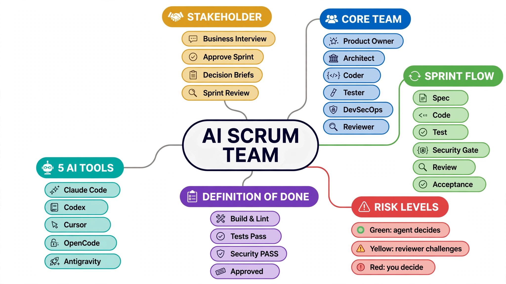

# AI Scrum Team Templates

An AI Scrum team that builds software for a non-technical stakeholder: a product-owner, architect, coder (or backend and frontend devs), tester, devsecops and reviewer hand work to each other through files. Risky decisions come to you as plain-language decision briefs, and a story is Done only after tests, a security gate, code review and acceptance all pass. Packaged for five AI coding tools.



## Use a template

Pick your tool, then copy the contents of its `dist/` folder, including hidden folders, into your project root. Each folder has its own README with the kickoff, sprint and quick-change prompts, and an explanation of what you do as the stakeholder.

| Tool | Copy from | Rules file | Agents |
|---|---|---|---|
| Claude Code | `dist/claude/` | `CLAUDE.md` | `.claude/agents/*.md` |
| OpenAI Codex | `dist/codex/` | `AGENTS.md` | `.codex/agents/*.toml` |
| Cursor | `dist/cursor/` | `.cursor/rules/ai-team.mdc` | `.cursor/agents/*.md` |
| OpenCode | `dist/opencode/` | `AGENTS.md` | `.opencode/agents/*.md` |
| Google Antigravity | `dist/antigravity/` | `AGENTS.md` | `.agents/agents/*.md` |

```sh
cp -R dist/claude/. /path/to/your-project/
```

## Quick start

After copying, open your tool in the project and paste the prompts below. The examples are for Claude Code; for other tools, swap the rules file and the "invoke" line using the table. Full instructions per tool: [Claude Code](dist/claude/README.md), [Codex](dist/codex/README.md), [Cursor](dist/cursor/README.md), [OpenCode](dist/opencode/README.md), [Antigravity](dist/antigravity/README.md).

**1. Kickoff** (once per project):
```
Kick off a new product: [WHAT YOU WANT, in your own words].
Act as the orchestrator defined in CLAUDE.md and run the Kickoff.
Invoke each agent as a subagent, one at a time.
Ask me the business interview questions and wait for my answers. Then finish the Kickoff and show me the backlog, any decision briefs and the first sprint plan.
```

**2. Run a sprint** (after you reply "approved" to the sprint plan):
```
Run sprint [NN] as defined in CLAUDE.md, story by story.
Invoke each agent as a subagent, one at a time.
Stop when the sprint is finished or nothing can proceed, then show me the sprint review.
```

**3. Quick change** (small, low-risk):
```
quick: [the change]
```

| Tool | Rules file | Invoke line |
|---|---|---|
| Claude Code | `CLAUDE.md` | Invoke each agent as a subagent, one at a time. |
| OpenAI Codex | `AGENTS.md` | Spawn subagent for each step, one at a time, and wait for it to finish. |
| Cursor | `.cursor/rules/ai-team.mdc` | Invoke each agent with its slash command (/product-owner, /architect, ...), one at a time. |
| OpenCode | `AGENTS.md` | Invoke each subagent via the Task tool, one at a time. |
| Google Antigravity | `AGENTS.md` | Use invoke_subagent for each step, one at a time. |

As the stakeholder, you only answer business questions, approve sprint plans, choose options in decision briefs (`decisions/`), and read sprint reviews (`sprints/`). You never review code.

Recommended models: a strong model (e.g. Opus) for product-owner, architect, devsecops and reviewer, and a fast, cheaper model (e.g. Sonnet) for coder, backend-dev, frontend-dev and tester. Each template sets this up in its agent files.

## Repository layout

```
shared/       content common to every tool (edit here first)
  RULES.md      roles, hard limits, kickoff, sprint workflow, risk process, definition of done, file formats
  agents/       the eight agent prompts (description + body)
  docs/         README sections included in every tool's README
  project/      backlog/ stories/ sprints/ decisions/ docs/ skeleton + example story
templates/    tool-specific parts only: front matter, file formats, orchestration notes
dist/         generated, ready-to-copy templates (do not edit by hand)
scripts/build.py
assets/       images used by this README
```

## Edit a template

1. Change shared content in `shared/`, and tool-specific content in `templates/<tool>/`.
2. Run `python3 scripts/build.py` to regenerate `dist/`.
3. Run `python3 scripts/build.py --check` to confirm `dist/` is up to date.

Files in `templates/` reference shared content with directives that the build expands:

| Directive | Expands to |
|---|---|
| `{{include PATH}}` | the whole file |
| `{{body PATH}}` | a shared agent prompt without its front matter |
| `{{description PATH}}` | the `description:` value from a shared agent's front matter |

To add a tool, create `templates/<tool>/` with its rules file, one agent file per `shared/agents/*.md` and a README, then rebuild. To add a role, add `shared/agents/<role>.md`, a wrapper in every `templates/<tool>/` agents folder, and the role to `shared/RULES.md` and `shared/docs/WORKFLOW.md`.
## License

[MIT](LICENSE)
